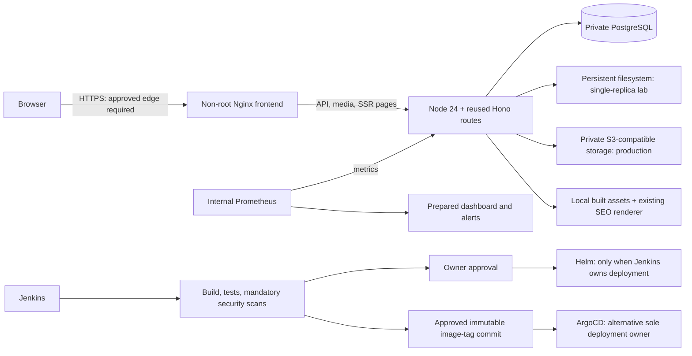

# Happy Furn AWS/Node migration

Prepared on local `feat/aws-kubernetes-fullstack`, based on the working application at `f45a40e`. **No push, merge, AWS/Kubernetes deployment, Terraform plan/apply, existing EC2/Jenkins/container change or live database migration is authorized/performed.** Local test containers are isolated, uniquely named and removed by their runners. Production readiness is **not established** by local tests.

## Architecture



The React UI, Hono APIs, authentication/authorization, PBKDF2/session revocation, rate limits, validation, quotation receipts/retries, private supplier tracking, image CAS/cleanup, lead follow-up and server-rendered SEO are reused. Cloudflare worker/configuration and all ten original D1 migrations remain unchanged and separately testable. Node provides D1-shaped PostgreSQL, private media and ASSETS adapters; it does not duplicate business logic or introduce checkout/payment collection.

PostgreSQL uses at most five pooled connections per process, bounded connect/query timeouts, parameterized values and single-client batch transactions. BIGINT is decoded only when safely representable in JavaScript; millisecond session expiry remains numeric. The migration runner uses advisory locking, per-file transactions and immutable checksums; it refuses unknown/modified history and never resets data. Application startup never applies migrations. Readiness checks applied migration names/checksums, permits a newer additive schema for compatible application rollback, and returns 503 on missing/unavailable history; liveness remains independent of DB availability. Real live D1 data import and production cutover have **not** been performed.

Node rejects unreviewed hosts, fixes CSRF/canonical origin to PUBLIC_ORIGIN and overwrites client-supplied CF-Connecting-IP using the socket plus explicitly trusted proxy CIDRs. Forwarded headers are ignored by default. Production requires HTTPS public origin, verified database TLS, a correctly shaped owner hash and strong session secret. Unsafe database TLS overrides in connection strings are rejected; malformed credential-bearing config URLs are redacted. Nginx appends its actual socket peer to X-Forwarded-For; Node walks the chain from the socket and stops at the first untrusted hop, ignoring forged entries further left. Include every actual trusted proxy hop (not untrusted client networks) and preserve the public Host at the TLS edge. Nginx uses privacy-safe coarse route/status access logs, not IPs, queries, cookies or request bodies. Configure actual trusted proxy subnets before public traffic; empty trust safely groups requests by the last socket peer and can rate-limit all visitors together.

Static product/category/contact/guide pages go through the existing SEO renderer; Nginx serves built assets directly and proxies API/media/application routes. Metrics/liveness/readiness are not exposed through the public Nginx route. Backend metrics use bounded route/method labels, never customer/product IDs, contacts, quotes or supplier prices.

## Local development and repeatable tests

Node 24+ and a **local** Docker daemon are required. Do not point Docker/Kubernetes tools at existing EC2 infrastructure. Keep inherited proxy/CA trust; managed-cloud builds may require the optional `proxy_ca` BuildKit secret documented in the environment skill. Never disable TLS verification.

```sh
npm ci
npm run build:frontend
npm run build:backend
npm test
npm run test:postgres
npm run test:s3
```

The PostgreSQL test creates a unique loopback-only container/database, applies ten migrations, tests APIs/failures and removes only its own container. The S3 test uses an isolated local Moto emulator; it sends signed SDK HTTP requests but **does not prove AWS IAM, TLS, bucket privacy or real S3 service readiness**. The attempted public MinIO fixture image was unavailable, so it is not claimed as tested. No remote fallback is permitted in either runner. Existing browser suites remain `npm run test:e2e` and `npm run test:e2e:preview` after frontend build.

Generate a **new local-only** env file without printing passwords or overwriting existing configuration (Bash):

```sh
read -r -s -p 'Unique local owner password: ' lab_owner_password
printf '%s' "$lab_owner_password" | npm run --silent lab:env
unset lab_owner_password
```

`.env.lab` is ignored and created mode 0600. It contains a salted hash, random database password/session key and port 8081, never the plaintext owner password. Do not reuse these values in production or commit the file. No default working credentials exist.

```sh
docker build -f deploy/docker/backend.Dockerfile -t happy-furn-backend:lab .
docker build -f deploy/docker/frontend.Dockerfile -t happy-furn-frontend:lab .
docker build -f deploy/docker/postgres.Dockerfile -t happy-furn-postgres:lab .
docker compose --env-file .env.lab config --quiet
docker compose --env-file .env.lab up -d --no-build --wait
```

The backend and frontend are multi-stage, non-root images with health checks. Runtime bases are pinned by digest. The backend has a separate locked seven-package runtime manifest at `server/runtime`; frontend/build dependencies and npm/Yarn are excluded from its runtime. When updating a direct backend dependency, update both lockfiles deliberately, audit both, rebuild and repeat the container smoke/security scans. The frontend uses one worker for predictable lab memory. Database and media use named volumes; only the frontend joins an edge bridge for its loopback-published port; database/backend services stay on a private internal bridge with no host port and no privileged capabilities. Runtime memory limits total about 1.2 GiB for the application/database; migration container is transient. This is configured budgeting, **not an 8 GiB host load benchmark**. Jenkins, SonarQube, monitoring and image scanning require additional/serial capacity and are not started by Compose.

Do not occupy Jenkins **8080**, an existing frontend **8081**, or Kubernetes forwarding **8090**. Default local frontend remains `127.0.0.1:8081`. If the old frontend already uses it, leave it untouched and use a free **temporary lab port**, e.g. `FRONTEND_PORT=18081 docker compose --env-file .env.lab up ...`; both proxy and PUBLIC_ORIGIN follow the override. `npm run test:compose` uses a random available loopback port and private temporary credentials, checks real outages/persistence, and removes only its unique test project/volumes. Never run `down -v`, prune, restart or stop against an existing customer/EC2 project. Ordinary `docker compose ... down` retains the named lab data volumes; use volume removal only for disposable fixtures.

## Required environment and secrets

| Name                                          | Purpose / boundary                                                                                                                                 |
| --------------------------------------------- | -------------------------------------------------------------------------------------------------------------------------------------------------- |
| `DATABASE_URL`                                | Secret PostgreSQL DSN; app role should have only necessary DML privileges. Separate migration role may need DDL                                    |
| `ENVIRONMENT`                                 | Explicit `development` (exact loopback origin only) or `production`                                                                                |
| `PUBLIC_ORIGIN`                               | Exact public origin for Host/CSRF/SEO; HTTPS mandatory in production                                                                               |
| `DATABASE_SSL`                                | `true` mandatory in production; verifies server certificates, no `sslmode` overrides in DSN                                                        |
| `OWNER_PASSWORD_HASH`                         | Secret existing PBKDF2 format, generated privately with `npm run owner:hash`; production salt/hash shape checked                                   |
| `SESSION_SECRET`                              | Secret, at least 32 random characters; rotation revokes existing sessions                                                                          |
| `MEDIA_DRIVER`                                | Explicit `filesystem`, `s3` or `disabled`; disabled preserves no-storage behavior                                                                  |
| `MEDIA_ROOT`                                  | Durable local/PVC path for filesystem mode; never a publicly served directory                                                                      |
| `AWS_REGION`, `S3_BUCKET`                     | Required for S3 mode; bucket must remain private                                                                                                   |
| `S3_ENDPOINT`, `S3_FORCE_PATH_STYLE`          | Optional compatible endpoint; TLS/no embedded credentials required in production                                                                   |
| AWS SDK identity                              | Approved workload role preferred; never frontend credentials or committed access keys. Default SDK chain is reused                                 |
| `TRUSTED_PROXY_CIDRS`                         | Narrow actual frontend/edge CIDRs; trust-all masks rejected. Empty trusts no forwarded client IP                                                   |
| `BIND_ADDRESS`, `PORT`, `STATIC_ROOT`         | Defaults loopback binding, port 3000 and local `dist`; container configs explicitly bind all container interfaces without publishing backend ports |
| `PREVIEW_MODE`                                | Keep `true` for noindex preview; changing indexing requires business/SEO review                                                                    |
| `EMAIL_MODE`                                  | Keep `disabled` for preview; `local` is development simulation only                                                                                |
| `RESEND_API_KEY`, `OWNER_EMAIL`, `EMAIL_FROM` | Optional server-only email provider settings; existing handler persists before notification. Live delivery unverified                              |
| `ALLOW_REMOTE_MIGRATIONS`                     | Explicit opt-in for separately approved non-local migration targets; never set automatically by application startup                                |

Use approved CA trust (`NODE_EXTRA_CA_CERTS`/mounted public CA bundle) for private database/storage certificates. S3 client operations are timeout/retry bounded; filesystem writes are atomic, path-checked and symlink-protected. Neither storage driver creates a bucket, grants public access or exposes provider URLs/credentials. Existing DB-backed publication checks and durable cleanup obligations remain authoritative.

## Kubernetes and Helm (prepared; not deployed)

`deploy/helm/happy-furn` is the source of truth; `deploy/kubernetes/all.yaml` is a rendered lab example. Regenerate after changing chart/values; do not maintain two independent application implementations. Use Kubernetes 1.32+ for the explicit StatefulSet PVC retention policy; media PVCs are also annotated for Helm retention. One release per namespace. Both services are ClusterIP, PostgreSQL is a private headless Service/one-replica StatefulSet, storage uses PVCs, pods are non-root with dropped capabilities, read-only root filesystems, probes, resource budgets, rolling update/history and default-deny network policies. The lab PostgreSQL image reuses the upstream entrypoint, runs UID/GID 70 and removes the unused root-only gosu helper after its vulnerable Go runtime was detected. Fresh lab volumes must be writable by UID 70; existing-volume ownership needs separate review, never an automatic recursive chown. Load/publish all three approved images into the cluster runtime first; a local Docker build alone does not make an image available to Kubernetes/containerd. The lab is **not** PostgreSQL HA, a backup system, or a production AWS cluster design.

```sh
helm lint deploy/helm/happy-furn
helm template happy-furn deploy/helm/happy-furn > /tmp/happy-furn-lab.yaml
kubeconform -strict -summary -kubernetes-version 1.32.0 /tmp/happy-furn-lab.yaml
helm template happy-furn deploy/helm/happy-furn -f deploy/helm/happy-furn/values/production.yaml > /tmp/happy-furn-production.yaml
kubeconform -strict -summary -kubernetes-version 1.32.0 /tmp/happy-furn-production.yaml
```

No cluster access is needed for these checks. Production values disable the lab DB, require database TLS, use two backend replicas and S3. Filesystem mode explicitly refuses multiple backend replicas. Set reviewed image repositories/immutable tags, real HTTPS origin, existing secret name, storage class, trusted frontend proxy CIDRs, IAM identity and explicitly allowed external DB/S3 egress CIDRs. Defaults have no external backend egress; do not weaken to wildcard egress just to hide configuration failure. A NetworkPolicy-capable CNI is required. Configured production values contain deliberate placeholders, not a deployable business target.

**Only after explicit deployment approval** and target/backup review, lab bootstrap can use:

```sh
# Review context explicitly; never use an implicit production current-context.
kubectl --context APPROVED_CONTEXT create namespace happy-furn-lab
# Prepare the existing secret privately; secrets.yaml.example is NEVER applied as-is.
kubectl --context APPROVED_CONTEXT -n happy-furn-lab create secret generic happy-furn-secrets --from-env-file=PRIVATE_K8S_ENV_FILE
helm upgrade --install happy-furn deploy/helm/happy-furn --kube-context APPROVED_CONTEXT -n happy-furn-lab --set-string backend.image.tag=REVIEWED_SHA --set-string frontend.image.tag=REVIEWED_SHA --set-string postgres.image=happy-furn-postgres:REVIEWED_SHA
kubectl --context APPROVED_CONTEXT -n happy-furn-lab rollout status statefulset/postgres --timeout=180s
# Review backup/restoration and image/target, then render the separate migration Job example privately.
kubectl --context APPROVED_CONTEXT apply -f PRIVATE_REVIEWED_MIGRATION_JOB.yaml
kubectl --context APPROVED_CONTEXT -n happy-furn-lab wait --for=condition=complete job/REVIEWED_MIGRATION_JOB --timeout=180s
kubectl --context APPROVED_CONTEXT -n happy-furn-lab rollout status deployment/backend --timeout=180s
kubectl --context APPROVED_CONTEXT -n happy-furn-lab rollout status deployment/frontend --timeout=180s
kubectl --context APPROVED_CONTEXT -n happy-furn-lab port-forward service/frontend 8090:8080 --address 127.0.0.1
```

These commands were **not executed**. The first lab install intentionally does not wait before the separate migration job: backend readiness must remain false while the schema is absent. The example Job is not a Helm hook and never runs implicitly during deployment. For production/external PostgreSQL, provision approved schema/credentials independently before the application release; never use the lab StatefulSet as an HA production database. Do not apply example placeholders or expose PostgreSQL with NodePort/LoadBalancer/hostPort.

## Jenkins, GitOps and monitoring

`Jenkinsfile` defaults publishing/deployment **off** and deployment owner `none`. Agent label `happy-furn-tools` must provide Node 24, Docker, Helm, Terraform, Trivy, kubeconform and jq; missing mandatory tools/scans fail. It runs checkout, compile/format, unit, real PostgreSQL and local S3-emulator integration, both builds, optional explicitly reported SonarQube/quality gate, mandatory dependency/source/image scans, Docker builds/Compose outage tests, Helm/schema/Terraform checks, approved immutable image publishing, distinct production approval, explicit-context deployment, rollout/HTTPS checks and eligible application rollback. It never applies database migrations or Terraform. Registry/kubeconfig credentials are private Jenkins bindings, not committed. Configure restricted credentials, registry, actual production values, context/namespace and health target. Create the Jenkins security-realm group `happy-furn-release-approvers` and restrict it to authorized release reviewers; the submitter list is fixed in code, never caller-supplied. Publishing/deployment also require REVIEWED_COMMIT to equal the checked-out SHA. Restrict job/SCM configuration, credential scope and Build permissions; never expose credentials to untrusted PR pipelines. Source checks compile Groovy syntax only; **Jenkins Declarative validation/plugins, SonarQube, registry publishing and deployment were not run against an external Jenkins**.

Choose exactly one release owner. If `argocd`, Jenkins only tests/scans/publishes approved images and reports a GitOps handoff; it refuses Helm deployment. Update `values/gitops-lab.yaml` with reviewed image tags in an approved commit, pin the Application's source revision and manually sync ArgoCD. No automatic prune/sync or namespace creation is enabled. AppProject restricts repository, namespace and resource kinds; secrets/cluster resources are external prerequisites. No GitOps commit/push or ArgoCD sync occurred here.

`/metrics` is backend-internal. Prometheus config, six alerts (scrape/DB readiness/5xx/restarts/memory/CPU) and Grafana dashboard are under `deploy/monitoring`. Optional ServiceMonitor requires preinstalled Prometheus Operator CRDs; kube-state-metrics and kubelet/cAdvisor scraping/RBAC/TLS must be supplied by the approved monitoring stack. promtool syntax checks do not establish live dashboards/alert delivery. Monitoring was not installed on Kubernetes.

## Terraform (prepare/validate only)

```sh
terraform -chdir=infra/terraform fmt -check
terraform -chdir=infra/terraform init -backend=false -input=false
terraform -chdir=infra/terraform validate
```

These validation operations need public provider downloads, not AWS credentials or resource creation. The locked provider/version checks are recorded in VALIDATION.md. `enable_infrastructure=false` and `create_media_bucket=false` default to no resources. Prepared resources include VPC/subnet/routes/SG, optional private-IP EC2 with IMDSv2, restricted SSM role, encrypted retained EBS and optional encrypted/versioned/private TLS-only S3. No NAT Gateway, load balancer, RDS, paid endpoint, key creation, agent install or automatic cluster bootstrap. No existing instance/volume/resource is imported or managed.

Any future EC2/EBS/S3/public-IP usage can be billable; do not call it Free Tier without checking the account. Review AMI/region/AZ, 8-GiB instance size/costs, CIDRs, existing SSH key, state encryption/locking, IAM and backup policies. Default private-only instance has **no guaranteed internet/SSM connectivity**: approved egress/access is an owner prerequisite; no hidden NAT/LB is added. Extra EBS is not formatted/mounted automatically. S3 workload IAM is not automatically attached to Kubernetes pods. No `plan`, `apply`, `destroy`, AWS login or existing EC2 change was run.

## Rollback and recovery

1. Stop traffic/changes only through an approved incident procedure; first capture evidence and preserve DB/media backups privately.
2. For a failed compatible application release, select a known prior immutable image/chart revision. Jenkins records a previous revision and runs `helm rollback happy-furn REVISION --kube-context APPROVED_CONTEXT -n NAMESPACE --wait --timeout 180s` only after an actual approved Jenkins deployment failed. No earlier release means no automatic uninstall/deletion; owner intervention is required.
3. If ArgoCD owns deployment, revert the approved GitOps image-tag commit and manually sync that reviewed source revision. Do not also use Jenkins Helm rollback against ArgoCD-owned resources.
4. **No automatic database downgrade.** Forward migrations are transactional/checksummed. Fix-forward additive schema errors when possible. A backup restore can discard newer customer records and needs explicit approval, a separate target/rehearsal and reconciliation; no restore/destroy is hidden in these scripts.
5. Filesystem/PVC or S3 versioned object recovery must be reconciled with DB media registry/cleanup records; restoring bytes alone does not publish a gallery. Current D1/R2 implementation remains available as the existing application path until an approved cutover is verified.

See [ASSESSMENT.md](ASSESSMENT.md), [MIGRATION_COMPATIBILITY.md](MIGRATION_COMPATIBILITY.md) and [VALIDATION.md](VALIDATION.md) for actual evidence, files, limitations and remaining blockers.
